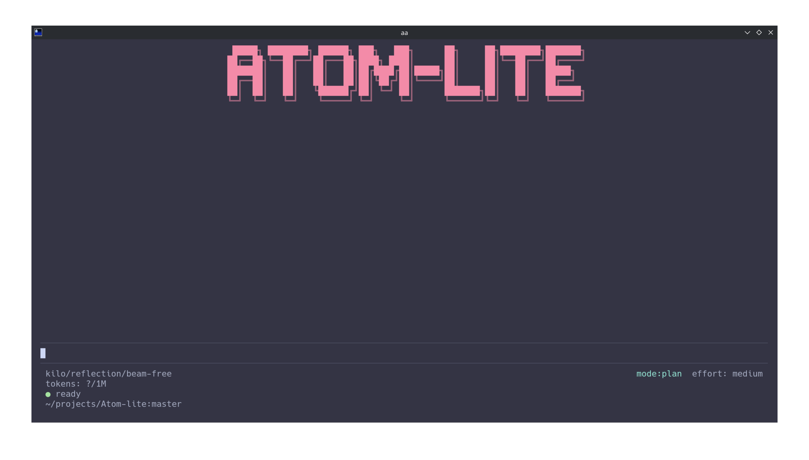

# Atom-lite

<p align="center">
  
</p>

[](https://www.npmjs.com/package/atom-lite)
[](https://github.com/beast-ofcourse/atom-lite/actions/workflows/ci.yml)
[](https://nodejs.org)
[](https://www.typescriptlang.org)
[](./LICENSE)

Atom-lite is a local-first, model-agnostic coding agent built on a deliberately small harness: one agent loop, eight built-in tools, a conflict-aware scheduler, durable JSONL sessions, and explicit safety boundaries. It runs against local or hosted providers through interchangeable adapters — no cloud account, telemetry, or control plane required.

> Documentation index: [`docs/README.md`](./docs/README.md). Architectural decisions: [`docs/adr/`](./docs/adr/).

## Why Atom-lite

Most coding agents accumulate tools, sub-agents, and orchestration until the harness becomes the product. Atom-lite takes the opposite stance:

- **Small core, strong primitives.** Provider interface, session model, one agent loop, six tools, scheduler/executor, context management, config, and CLI.
- **The model decides; the runtime enforces.** The model chooses tools and next steps; the runtime validates arguments, enforces workspace boundaries, applies approval rules, schedules calls safely, and returns accurate results. No hard-coded workflow.
- **Thin harness, not weak engineering.** Streaming failures, concurrent file access, shell timeouts, large outputs, context exhaustion, and session recovery are handled as the reliability layer.

## Features

- **Eight built-in tools** — `read`, `write`, `edit`, `bash`, `grep`, `glob`, `webfetch`, `websearch`. Everything else (tests, git, builds) runs through `bash`.
- **Single agent loop** — one agent, one conversation, one registry, one control loop. Parallelism lives inside a tool-call batch.
- **Conflict-aware scheduler** — per-file read/write locks and a global bash barrier.
- **Durable sessions** — append-only JSONL event logs, resumable across restarts, grouped by workspace.
- **Context management** — token estimation and compaction before the budget is exceeded, full transcript retained.
- **Live context meter** — `tokens: 4.5k/256k` against the model's real window, resolved from provider metadata with fallbacks.
- **Approval modes** — `ask` / `trusted` / `deny` for shell commands, with session-level trust.
- **Hash guards** — `expected_hash` rejects stale `write`/`edit` when a file changed since read.
- **Provider-agnostic** — Ollama, Gemini, and any OpenAI-compatible endpoint (LM Studio, llama.cpp, Kilo, OpenAI, Anthropic, OpenRouter, Groq, Mistral, xAI, …).
- **Interactive pickers** — `/provider` adds a provider and stores its key securely; `/model` fuzzy-searches every configured provider's models.
- **Command palette & themes** — `ctrl+p` fuzzy-searches commands, skills, providers, models, themes, sessions. `/theme` switches auto/dark/light/no-colour.
- **Local-first** — runs fully against local providers; no telemetry or hosted database.
- **Safe path handling** — file tools resolve against the workspace and reject escapes; shell is an explicit boundary.

## Install

```sh
npm install -g atom-lite
```

Or run without installing:

```sh
npx atom-lite "fix the failing test"
```

Requires **Node.js >= 22.19**.

## Quick start

```sh
atom-lite                 # interactive session in the current directory
atom-lite "task"          # run one task, then exit
atom-lite --provider NAME # select a provider profile
atom-lite --continue      # resume the most recent session
atom-lite --help
```

Pipe a task via stdin:

```sh
echo "summarize this repo" | atom-lite
```

## Default provider

Out of the box, Atom-lite uses the **Kilo AI Gateway** (`https://api.kilo.ai/api/gateway`) with the free `kilo-auto/free` model. No API key required (rate-limited to 200 requests/hour per IP for anonymous use). Override via `--provider`/`--model` or config.

## Configuration

- User config: `~/.config/atom-lite/config.json`
- Project config: `.atom-lite/config.json` (non-secrets only)

Precedence (low → high): defaults → user config → project config (non-secret) → environment → CLI overrides. Security-critical user settings (e.g. `approvalMode`) are not overridable by project config.

Secrets live in `~/.config/atom-lite/credentials.json` (`0600`). Environment variables named by a provider's `apiKeyEnv` take precedence over the stored key. Secrets are never written to project config or session files.

| Variable | Effect |
| --- | --- |
| `ATOM_LITE_PROVIDER` | Default provider profile name |
| `ATOM_LITE_APPROVAL_MODE` | `ask` / `trusted` / `deny` |

See [`docs/configuration.md`](./docs/configuration.md) for every field, default, and precedence rule.

## Usage

```
atom-lite [task] [--provider NAME] [--model MODEL] [--continue] [--session ID]
          [--list-sessions] [--search-sessions QUERY] [--no-tools] [--json]
          [--debug] [--theme NAME] [--no-color] [--version] [--help]
```

| Flag | Description |
| --- | --- |
| `task` | One-shot task; agent runs it and exits |
| `--provider NAME` | Select a provider profile |
| `--model MODEL` | Override the model for this run |
| `--continue` | Resume the most recent session in this workspace |
| `--session ID` | Resume a specific session |
| `--list-sessions` | Print the session index and exit |
| `--search-sessions QUERY` | Print matching sessions with snippets and exit |
| `--no-tools` | Disable all tools (model-only chat) |
| `--json` | Non-interactive JSON output |
| `--debug` | Debug logging |
| `--theme NAME` | Use `auto`, `dark`, `light`, or `ansi` for this run |
| `--no-color` | Force the no-colour theme |
| `--version` | Print version |
| `--help` | Show help |

In the TUI, type `/help` for every command grouped by category, or press `ctrl+p` for the fuzzy command palette. `/theme` opens a live-preview picker and persists your choice; `NO_COLOR` and `--no-color` always win. `/sessions` opens a searchable picker scoped to the current workspace; `/search <query>` prints matching sessions with snippets. Mouse wheel scrolling and click-to-focus are enabled for interactive terminals and can be disabled with `ui.mouse: false`.

## Tools

Eight built-in tools — the four core tools from [ADR 0001](./docs/adr/0001-four-built-in-tools-only.md), file search, plus the additive network tools from [ADR 0006](./docs/adr/0006-expanded-toolset.md):

| Tool | Purpose |
| --- | --- |
| `read` | Inspect files (with optional line ranges) |
| `write` | Create or replace files safely (hash-guarded) |
| `edit` | Precise find-and-replace edits (hash-guarded) |
| `bash` | Execute shell commands (global exclusive barrier by default) |
| `grep` | Search file contents by regex (ripgrep-backed, falls back to JS) |
| `glob` | Find files matching a glob pattern |
| `webfetch` | Fetch a URL and convert HTML to markdown |
| `websearch` | Search the web and return ranked results |

Tests, Git, builds, formatters, and package managers are available through `bash`.

## Providers

| Type | Adapter | Notes |
| --- | --- | --- |
| `openai-compatible` | `OpenAICompatibleAdapter` | LM Studio, llama.cpp/llama-server, Kilo, and other compatible endpoints |
| `ollama` | `OllamaAdapter` | Native Ollama chat API |
| `gemini` | `GeminiAdapter` | Official Gemini API |

Provider profiles are named combinations of endpoint, model, auth source, and options. Switching profiles mid-tool-exchange is disallowed.

### Interactive setup

- `/provider` opens a searchable list of built-in providers (Kilo, OpenAI, Anthropic, Google Gemini, OpenRouter, Groq, Mistral, xAI, Ollama, LM Studio, llama.cpp). Selecting a hosted provider prompts for an API key with hidden input, validates it, and saves it to `~/.config/atom-lite/credentials.json` (`0600`).
- `/model` opens a fuzzy-searchable picker containing models from every configured provider (plus providers whose key is present in the environment). Live model lists are fetched in the background.
- `/model <provider>/<model>` and `/provider <name>` are the non-interactive forms.

The selected provider/model is persisted to user config, so the next session starts where you left off.

## Safety & security

- **Workspace boundary** — `read`/`write`/`edit` resolve paths against the workspace and reject escapes. Shell commands are not constrained by this boundary, so `bash` runs as a global exclusive barrier.
- **Approval modes** — `ask` prompts before each shell command; `trusted` auto-approves; `deny` blocks. Session trust can be granted interactively (`t`).
- **Hash guards** — prevent stale overwrites when a file changed since it was read.
- **Sandboxing flags** — reported per command; see `src/security/`.
- **No secrets in config** — interactive setup stores API keys in `~/.config/atom-lite/credentials.json` (`0600`); environment variables take precedence.
- **Local-first** — no cloud account, telemetry, or remote control plane required (see [ADR 0004](./docs/adr/0004-local-first-no-cloud-dependency.md)).

## Commands

Type `/help` for the grouped list, or press `ctrl+p` for the fuzzy command palette. Common commands:

| Command | Description |
| --- | --- |
| `/model [model]` | Show or switch the active model |
| `/provider [profile]` | Show or switch the active provider |
| `/effort [low\|medium\|high]` | Set reasoning effort |
| `/session [rename <title>]` | Show or rename the current session |
| `/sessions [all]` | Search and resume a session |
| `/search <query>` | Search sessions by title or content |
| `/export [path]` | Export the session transcript |
| `/mcp [reconnect [server]]` | Inspect or reconnect MCP servers |
| `/extensions` | List discovered extensions and load status |
| `/compact` | Compact older context |
| `/clear` | Clear the transcript view |
| `/approval` | Change approval mode |
| `/doctor` | Run diagnostics |
| `/thinking` | Toggle thinking display |
| `/theme [auto\|dark\|light\|ansi]` | Switch theme |
| `/skills`, `/skill <name>` | List or load a skill |
| `/exit` | Exit the TUI |

## Sessions

Sessions are append-only JSONL event logs recording everything in one conversation. They are resumable across CLI restarts and grouped by workspace. The session index derives a title from the first user message unless `/session rename <title>` overrides it, and records the provider, update time, and message count. `/sessions` resumes a session in place: retained messages are replayed into the transcript and a `session_resumed` event is appended. `/search <query>` matches titles, message content, and workspace paths, ranking title hits first. `--list-sessions` and `--search-sessions` print the same index as stable tab-separated rows for scripts. Compaction summarizes older history to stay within the context budget while retaining the full transcript.

## Context management

The context manager builds model input, estimates tokens, and triggers compaction before the context budget is exceeded. It also loads project instructions (e.g. `AGENTS.md`/`CLAUDE.md`-style files) subject to `maxProjectInstructionBytes`.

## Development

```sh
npm install
npm run dev        # run via tsx (src/cli/main.ts)
npm start          # build and run
npm run typecheck  # tsc --noEmit
npm test           # build + node --test
npm run build      # tsc
npm run format     # prettier --write .
```

Tests live in `tests/` (agent, config, runtime, tools). The project is TypeScript (strict) on NodeNext ESM.

### Releasing

1. Update `version` in `package.json` and add a `CHANGELOG.md` entry.
2. Run `npm run typecheck && npm test && npm run bench`.
3. Commit, then tag and push: `git tag vX.Y.Z && git push origin master --tags`.
4. The `Release` workflow stages the package on npm with provenance and opens a draft GitHub release. It requires an `NPM_TOKEN` repository secret with publish access.
5. Approve the staged version on npm (Staged Packages tab, or `npm stage approve <stage-id>` with 2FA), then publish the draft release on GitHub.

npm requires a maintainer with 2FA to approve staged releases; CI cannot complete that step.

## Architecture

```
src/
  agent/        # agent loop & types
  cli/          # terminal UI, approvals, commands
  config/       # schema, defaults, loader
  context/      # builder, manager, compaction, budget, instructions
  providers/    # adapters (openai-compatible, ollama, gemini, fake) + factory
  runtime/      # scheduler, approvals
  security/     # paths, process, redaction
  sessions/     # store, events, recovery
  tools/        # read, write, edit, bash, grep, glob, webfetch, websearch, registry
```

Key design decisions are recorded as ADRs in [`docs/adr/`](./docs/adr/):

- [0001 — Four built-in tools only](./docs/adr/0001-four-built-in-tools-only.md)
- [0002 — Single agent loop, no sub-agents in v1](./docs/adr/0002-single-agent-loop.md)
- [0003 — `bash` is a global exclusive barrier](./docs/adr/0003-bash-as-global-exclusive-barrier.md)
- [0004 — Local-first, no cloud dependency](./docs/adr/0004-local-first-no-cloud-dependency.md)
- [0005 — OpenTUI for the terminal UI](./docs/adr/0005-opentui-for-terminal-ui.md) (superseded by 0007)
- [0006 — Expanded built-in toolset (webfetch, websearch)](./docs/adr/0006-expanded-toolset.md)
- [0007 — pi-tui replaces OpenTUI](./docs/adr/0007-pi-tui-replaces-opentui.md)

## Contributing

Read [`CONTRIBUTING.md`](./CONTRIBUTING.md) before opening a pull request. Issues and specs live as markdown under `.scratch/` (see [`docs/agents/issue-tracker.md`](./docs/agents/issue-tracker.md)). Keep changes consistent with the "small core" principle: new tools require strong justification against ADR 0001.

Report vulnerabilities privately as described in [`SECURITY.md`](./SECURITY.md).

## License

MIT
